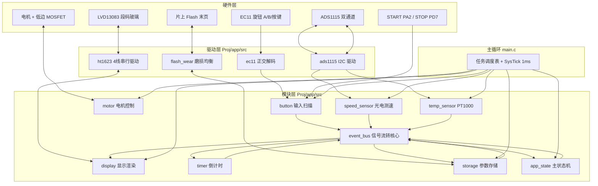
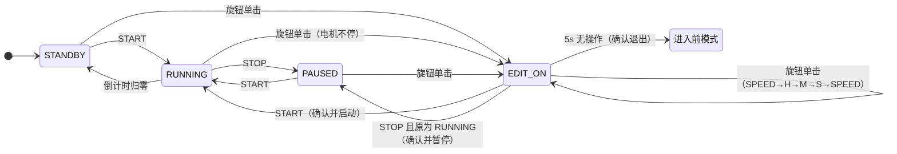

# 软件架构设计 — ES 电机驱动板

> **定位**：后续所有需求的开发必须遵循本架构，不得绕过。
> **上游依据**：《需求细分拆解.md》（REQ-XXX）、《产品认知摘要.md》（A1~A17）。
> **目标平台**：HK32F0301MF4P7C（ARM Cortex-M0，48MHz，16KB Flash），Keil MDK + ARMCLANG V6.19+。
> **架构硬性约束（本文档即为落地）**：
> 1. 超级循环 + 状态机；2. 模块化（每模块独立 .c/.h）；3. 类面向对象统一接口；4. 统一信号流转机制；5. 明确的互斥与同步策略。

---

## 1. 架构总览

### 1.1 总框图



### 1.2 分层原则

| 层 | 内容 | 规则 |
|---|---|---|
| 硬件层 | 芯片引脚、外设、玻璃屏、传感器 | 仅驱动层可见 |
| 驱动层 | 芯片级协议（HT1623/ADS1115/Flash/正交解码） | 不包含任何业务语义 |
| 模块层 | 9 个业务模块 + 事件总线 | 模块间只经事件总线与白名单接口通信 |
| 主循环 | `main.c`：初始化 + 调度表 + 事件分发 | 唯一允许跨模块编排的位置 |

---

## 2. 模块清单与职责表

| # | 模块 | 文件（`Proj/app/`） | 职责 | 对应需求域 |
|---|---|---|---|---|
| 1 | **event_bus**（信号流转核心） | `src/event_bus.c` | 事件定义、投递、订阅与广播分发 | 全部（SYS-01 支撑） |
| 2 | **app_state**（主状态机） | `src/app_state.c` | 主模式×编辑层正交状态机、事件消费、参数变更、到达判定、倒计时协调、派生事件发布 | SM、MOT-03、TIMER-01/03/04 |
| 3 | **display**（屏幕） | `src/display.c` | 字段渲染（4 数据区+图标区+隔断线）、闪烁相位、差分写屏 | DISP、ICON |
| 4 | **button**（按键扫描） | `src/button.c` | 消费 EC11 增量（EXTI 硬件捕获）+ 三键消抖、按下沿/增量事件产生 | IN |
| 5 | **motor**（电机控制） | `src/motor.c` | PWM 输出（TIM1_CH2 10kHz）、RPM-占空比 LUT、斜坡、闭环 | MOT-01/04/05 |
| 6 | **speed_sensor**（光电测速） | `src/speed_sensor.c` | PB4/EXTI4 周期法测速（TIM6 µs 时基）、滤波、停转检测 | MOT-02 |
| 7 | **temp_sensor**（PT1000 测温） | `src/temp_sensor.c` | ADC 采样、阻值/温度换算、0.1℃ 分辨率、在位检测 | TEMP |
| 8 | **timer**（倒计时） | `src/timer.c` | 剩余时间模型、启停/重载/每秒递减、归零事件 | TIMER |
| 9 | **storage**（参数存取） | `src/storage.c` | 末页 slot 磨损均衡、加载/分步写入、掉电保护 | STOR |
| — | 框架与调试支撑 | `src/app.c`（调度+编排）、`src/uart_cmd.c`（shell） | 超级循环、任务调度、UART 命令行（调试，非产品需求） | SYS-01（支撑） |
| — | 芯片驱动 | `src/ht1623.c`、`src/ads1115.c`、`src/ec11.c`、`src/flash_wear.c` | 芯片级协议（无业务） | 平台支撑 |

> 头文件与实现同名，位于 `Proj/app/inc/`；`app_cfg.h`（周期/假设常量/极性/引脚）也在此。

---

## 3. 统一模块接口（类面向对象）

### 3.1 强制接口（每个模块必须实现）

```c
/* 上电初始化：外设配置 + 对象状态复位 + 初始画面（如 display_init 渲染开机界面） */
void <module>_init(void);

/* 超级循环周期调用：模块自处理（轮询、状态推进、输出） */
void <module>_ops(void);
```

- 模块内部状态封装为**模块私有静态实例**（对象），如 `static motor_obj_t motor;`，模块外不可见。
- 对外只暴露：`_init` / `_ops` + 文档化的 get/set 接口；实现细节与私有函数一律 `static`。
- 周期由主循环调度表决定，模块自身不延时、不自旋等待。

### 3.2 各模块接口签名

#### event_bus

```c
typedef enum {
  EVT_NONE = 0,
  EVT_KEY_START,        /* START 按下沿       */
  EVT_KEY_STOP,         /* STOP 按下沿        */
  EVT_KNOB_PRESS,       /* 旋钮单击           */
  EVT_KNOB_CW,          /* 旋钮顺时针 1 格    */
  EVT_KNOB_CCW,         /* 旋钮逆时针 1 格    */
  EVT_PARAM_CHANGED,    /* 编辑值预览变化     */
  EVT_PARAM_CONFIRMED,  /* 参数确认（含落盘） */
  EVT_MODE_CHANGED,     /* 主模式迁移         */
  EVT_SPEED_UPDATED,    /* 实时转速刷新       */
  EVT_REACH_TARGET,     /* 实际转速到达目标   */
  EVT_CNTDOWN_ZERO,     /* 倒计时归零         */
  EVT_TEMP_VALID,       /* 探头插入           */
  EVT_TEMP_INVALID,     /* 探头拔出           */
  EVT_1S,               /* 秒节拍（housekeeping 产生） */
  EVT_BLINK_TOGGLE      /* 500ms 闪烁相位翻转 */
} evt_type_t;

typedef struct {
  evt_type_t type;
  uint16_t   val;     /* 载荷：如新的转速值 */
} evt_msg_t;

void    evt_bus_init(void);                                    /* 清空队列与订阅表 */
uint8_t evt_bus_post(evt_type_t type, uint16_t val);           /* 投递（仅主循环上下文！） */
uint8_t evt_bus_subscribe(evt_module_t mod, evt_type_t type);  /* 订阅（init 期完成） */
uint8_t evt_bus_dispatch(void);                                /* 主循环每轮调用：取出并广播，返回处理条数 */
```

#### app_state

```c
typedef enum { APP_STANDBY = 0, APP_RUNNING, APP_PAUSED } app_mode_t;
typedef enum { EDIT_NONE = 0, EDIT_SPEED, EDIT_TIME_H, EDIT_TIME_M, EDIT_TIME_S } edit_field_t;

typedef struct {
  app_mode_t  mode;           /* 主模式 */
  edit_field_t edit;          /* 编辑层 */
  uint16_t    cfg_rpm;        /* 目标转速（权威副本） */
  uint16_t    cfg_h; uint8_t cfg_m; uint8_t cfg_s;   /* 目标时间（权威副本） */
  uint16_t    idle_ms;        /* 编辑无操作计时 */
  uint8_t     time_edited;    /* 本次编辑是否改过时间 */
} app_state_obj_t;

void app_state_init(void);
void app_state_ops(void);                 /* 10ms：消费事件、状态迁移、5s 计时、到达判定、发布派生事件 */
app_mode_t app_state_get_mode(void);
edit_field_t app_state_get_edit(void);
uint16_t app_state_get_cfg_rpm(void);     /* 权威参数读接口（storage/display/motor 经此读取） */
void   app_state_get_cfg_time(uint16_t *h, uint8_t *m, uint8_t *s);
```

#### display

```c
typedef enum { FIELD_SET_SPEED, FIELD_SET_TIME, FIELD_INST_SPEED, FIELD_INST_TEMP, FIELD_REMAIN } disp_field_t;
typedef enum { ICON_CROSS, ICON_CLOCK, ICON_CIRCLE, ICON_ALARM, ICON_ARROW, ICON_DIVIDER } disp_icon_t;

typedef struct {
  uint8_t  ram[HT1623_RAM_NIBBLES];  /* 屏 RAM 镜像（单生产者：display_ops） */
  volatile uint8_t dirty;            /* 差分写屏标志 */
  uint8_t  blink_phase;              /* 当前闪烁相位（0/1） */
  uint8_t  field_blink[5];           /* 各字段是否闪烁 */
  uint8_t  icon_state[6];            /* 图标状态 */
  uint8_t  temp_hidden;              /* 温度整块隐藏 */
} display_obj_t;

void display_init(void);              /* HT1623 初始化 + 开机全显 */
void display_ops(void);               /* 50ms：渲染字段与图标 → 与旧镜像比较 → 差分写屏 */
void display_set_value(disp_field_t f, uint16_t v);        /* 数字字段值（含格式） */
void display_set_icon(disp_icon_t i, uint8_t on);
void display_set_blink(disp_field_t f, uint8_t blink);     /* 闪烁开关；相位由内部 500ms 翻转 */
void display_hide_temp(uint8_t hide);
void display_request_refresh(void);   /* 置 dirty，下个周期全量重渲染 */
```

#### button

```c
typedef struct {
  int32_t enc_pos;          /* 累计位置（±120 饱和） */
  int32_t enc_delta;        /* 待取增量（Task 消费） */
  uint8_t key_filter[3];    /* START/STOP/旋钮键 3 次稳定滤波 */
} button_obj_t;

void button_init(void);
void button_ops(void);      /* 2ms：消费 EC11 增量（EXTI ISR 捕获）+ 三键消抖；→ evt_bus_post */
```

#### motor

```c
typedef struct {
  uint16_t target_rpm;      /* 闭环目标（app_state 写入） */
  uint16_t out_rpm;         /* 参考轨迹（ramp，1000 RPM/s；启动无阶跃/A9 衰减显示） */
  uint16_t meas_rpm;        /* 实测转速缓存（EVT_SPEED_UPDATED 回调刷新） */
  uint8_t  enabled;         /* RUNNING 使能 */
} motor_obj_t;

void motor_init(void);                     /* TIM1_CH2 PD6 AF3, 10kHz, ARR=4799, 初始占空比 0 */
void motor_ops(void);                      /* 5ms：斜坡推进 + 速度环（内部 4 分频 → 20ms 节拍） */
void motor_on_event(evt_type_t t, uint16_t v);   /* 订阅回调：只缓存实测转速（回调只读纪律） */
void motor_set_target(uint16_t rpm);       /* 白名单接口（仅 app_state 调用）；不清积分（A14 运行中步进保持输出连续，防调速抖动） */
void motor_stop(void);                     /* 受控停转：输出归零、参考轨迹斜坡衰减到 0 */
void motor_halt(void);                     /* 立即停转并清零参考轨迹（倒计时归零路径） */
uint16_t motor_get_out_rpm(void);          /* 参考轨迹转速（显示/衰减显示用） */
uint16_t motor_get_duty_permille(void);
uint16_t motor_get_meas_rpm(void);         /* 实测转速缓存（诊断） */

/* 速度环整定接口（shell pid/pidkp/pidki；上板整定不改固件） */
uint16_t motor_get_kp_q8(void);  uint16_t motor_get_ki_q8(void);
void     motor_set_kp_q8(uint16_t v);      /* 0..4095（Q8，64=0.25‰/RPM） */
void     motor_set_ki_q8(uint16_t v);      /* 0..4095（Q8） */
void     motor_pid_get_info(motor_pid_info_t *info);   /* 诊断快照 */
```

#### speed_sensor

```c
typedef struct {
  uint16_t pulses;          /* 当前计数窗口脉冲数 */
  uint16_t window_ms;       /* 窗口时长（200ms） */
  uint16_t rpm;             /* 滤波后 RPM */
  uint16_t ppr;             /* 每转脉冲数（标定，A10） */
} speed_sensor_obj_t;

void speed_sensor_init(void);
void speed_sensor_ops(void);                /* 20ms：周期法算 RPM + 低通滤波 + 停转检测 */
uint16_t speed_sensor_get_rpm(void);        /* 滤波后实测转速（显示/到达判定/PID 共用） */
uint32_t speed_sensor_get_pulses(void);     /* 累计脉冲数（标定/调试；上电清零） */
void speed_sensor_set_ppr(uint16_t ppr);    /* 标定配置 */
```

#### temp_sensor

```c
typedef struct {
  int16_t  deci_c;          /* 温度 ×10（0.1℃） */
  uint8_t  valid;           /* 探头在位 */
  uint16_t raw;             /* 最近 ADC 原始值（调试） */
} temp_sensor_obj_t;

void temp_sensor_init(void);
void temp_sensor_ops(void);                 /* 500ms：ADS1115 采样 → 阻值换算 → 温度 + 在位判定 → 事件 */
int16_t temp_sensor_get_deci_c(void);
uint8_t temp_sensor_is_valid(void);
```

#### timer

```c
typedef struct {
  uint16_t rem_h; uint8_t rem_m; uint8_t rem_s;  /* 剩余时间 */
  uint8_t  active;          /* 倒计时进行中 */
} cntdown_obj_t;

void timer_init(void);
void timer_ops(void);                       /* 消费 EVT_1S：active 时递减；归零 → post EVT_CNTDOWN_ZERO */
void timer_load(uint16_t h, uint8_t m, uint8_t s);
void timer_pause(void);                     /* 冻结 */
void timer_resume(void);                    /* 恢复递减 */
void timer_get_rem(uint16_t *h, uint8_t *m, uint8_t *s);
```

#### storage

```c
typedef struct {
  uint16_t rpm; uint16_t h; uint8_t m; uint8_t s;
} user_param_t;

void storage_init(void);                                    /* 上电扫描最后有效槽 → 参数；无 → 默认（A13） */
void storage_ops(void);                                     /* 10ms：待写队列分步执行（每周期 ≤1 word） */
uint8_t storage_request_save(const user_param_t *p);        /* 请求持久化（确认时机） */
void storage_get_params(user_param_t *p);
```

> **实现注记（2026-09-14 模块化重构落地）**：实际代码与上述签名的差异点——
> 1. 全部实现位于 `Proj/app/src/`、头文件位于 `Proj/app/inc/`；`main.c` 仅保留 `App_Init()/App_Run()`，框架（调度表 + SysTick + 秒节拍）在 `app.c`。
> 2. `display` 采用**周期拉取式**渲染（50ms 经 getter 重建镜像），未实现 `display_set_value/set_icon/set_blink/hide_temp`；新增 `display_debug_*` 调试接口（shell `lcd` 命令用）。
> 3. `timer` 新增 `timer_is_active()`（时钟图标数据源）；递减由 `EVT_1S`（housekeeping 1000ms）驱动，回调只置标志。
> 4. `app_state` 新增 shell 接口：`app_state_set_speed/set_time/start/stop`（与 UI 路径语义一致）。
> 5. 新增 `uart_cmd`（调试 shell，含 `fputc` 重定向）与 4 个芯片驱动落位（ht1623/ads1115/ec11/flash_wear）。
> 6. `ec11` 升级为 **EXTI 双边沿硬件捕获**（PC5=EXTI5、PC3=EXTI3；ISR 查表累加 1/4 格，主循环 ÷4 取整格、余量保留），`ec11_ops()` 在 EXTI 模式下为空操作；保留 `EC11_USE_EXTI=0` 的 2ms 轮询回退；新增 shell 诊断命令 `knob`。
> 7. `speed_sensor` 已按 **PB4(=U15/SPEED_SW，与 USART1_RX 同网络)/EXTI4 单边沿计数**实现（**链路已上板验证通 2026-09-14；18 计数/圈已标定 2026-09-15**，A10 关闭）：ADS1115 旧骨架已移除；编码器与 USB-TTL 不可同时接（PB4 与串口同网络）。
> 8. `speed_sensor` 升级为**周期法测速**（2026-09-15）：TIM6 4µs 时基 + EXTI4 时间戳，20ms 任务平均周期→RPM、EMA 滤波（α=1/4）、无脉冲 200ms 停转归零；`display` 实时转速字段已接入 `speed_sensor_get_rpm()`（实测值）——到达判定（A12）与速度环 PID（motor 侧消费同一反馈）待后续。
> 9. **速度环落地（2026-09-15）**：`motor` 实现 FF(LUT 前馈) + PI 反馈闭环——反馈经事件总线订阅 `EVT_SPEED_UPDATED`（新增 `EVT_MOD_MOTOR`，`motor_on_event` 只缓存实测转速，无模块间直调）；20ms 节拍（5ms 任务内部 4 分频，与测速同频）、Q8 定点无浮点；参考轨迹=原 ramp（启动无阶跃、A9 衰减显示）；积分限幅抗饱和；输出仅限物理边界 0~100%（2026-09-15 用户决策：不设人为限制，此前 300‰/500‰ 下实测撞顶）；`SPEED_LOOP_EN=0` 回退开环。`app_state` 到达判定已切换实测转速（A12：|实际−目标|≤50 RPM 持续 1s，常量 `REACH_TOLERANCE_RPM/REACH_HOLD_MS`）；圆图标数据源切换 `speed_sensor_get_rpm()`。shell 新增 `pid/pidkp/pidki` 整定命令。Kp=64/Ki=6（Q8）为初值，待上板整定回填。
> 10. **屏显转速二次平滑（2026-09-15）**：`display` 对 Instant Speed 做显示层变速跟随滤波（`display_smooth_speed`，常量 `DISP_SPEED_JUMP_RPM=30`/`DISP_SPEED_SS_DIV=8`）——大偏差快速跟随保调速手感、稳态 1/8 强平滑防跳字、停转立即归零；**不动** `speed_sensor` 原始反馈（PID/A12 依赖其带宽）；圆图标同用平滑值。

---

## 4. 信号流转机制（event_bus）

### 4.1 设计要点

1. **产生**：外设事件由 `button_ops`（按键/旋钮）、`temp_sensor_ops`（探头插拔）、`speed_sensor_ops`（转速刷新）、`timer_ops`（归零）、`app_state_ops`（模式/参数/到达）在各自 `_ops()` 中调用 `evt_bus_post()`。
2. **投递**：写入固定容量环形队列（16 条）。**硬性约定：只在主循环上下文投递**，ISR 禁止投递（SysTick 仅递减任务计数器；EC11 EXTI 仅累加边沿计数）——单循环下天然免锁。
3. **分发**：`main` 循环每轮在任务轮询前调用 `evt_bus_dispatch()`：按队列顺序取出事件，依据 `init` 期建立的订阅表，**广播**给每个订阅模块（每个订阅者都收到同一事件，解决"按钮事件需同时分发给屏幕与电机控制"）。
4. **消费**：订阅回调为只读通知（置内部标志、刷新缓存），**回调内禁止再 post 与长操作**；需要派生的动作在模块自己下一次 `_ops()` 中执行（如 app_state 收到 EVT_KNOB_CW 后改参数，再在其 ops 中统一发布 EVT_PARAM_CHANGED）。
5. **白名单直调**：高频控制量（`motor_set_target`）经 app_state 直调 motor（避免事件队列往返延迟），直调仅限 app_state → 模块 get/set 接口；模块之间禁止互相直调。

### 4.2 订阅表（初值）

| 事件 | app_state | display | timer | motor |
|---|---|---|---|---|
| EVT_KEY_START / EVT_KEY_STOP | ✓ | — | — | — |
| EVT_KNOB_PRESS / EVT_KNOB_CW / EVT_KNOB_CCW | ✓ | — | — | — |
| EVT_PARAM_CHANGED | — | ✓（刷新数字） | — | — |
| EVT_PARAM_CONFIRMED | ✓ | ✓ | ✓（重载） | — |
| EVT_MODE_CHANGED | — | ✓（图标） | — | — |
| EVT_SPEED_UPDATED | —（到达判定经白名单 get） | ✓（InstSpeed） | — | ✓（缓存实测转速→速度环） |
| EVT_REACH_TARGET | ✓ | ✓（时钟图标） | ✓（resume） | — |
| EVT_CNTDOWN_ZERO | ✓（→STANDBY） | ✓（图标） | — | — |
| EVT_TEMP_VALID / INVALID | ✓ | ✓（隐藏/图标） | — | — |
| EVT_1S | ✓（1s 节拍） | — | ✓（递减） | — |
| EVT_BLINK_TOGGLE | ✓（闪烁相位源） | ✓ | — | — |

### 4.3 信号流转示例 1：按下 START

```mermaid
sequenceDiagram
  participant BTN as button
  participant EB as event_bus
  participant APP as app_state
  participant MOT as motor
  participant SPD as speed_sensor
  participant TMR as timer
  participant DSP as display
  participant STR as storage

  BTN->>EB: post(EVT_KEY_START)
  EB->>APP: 广播 EVT_KEY_START
  APP->>APP: 编辑中? 确认参数退出编辑; mode=RUNNING
  APP->>STR: 确认时请求保存（storage_request_save）
  APP->>MOT: motor_set_target(cfg_rpm)
  APP->>TMR: 全新启动/改过时间? timer_load : 保持冻结值
  APP->>EB: post(EVT_MODE_CHANGED)
  EB->>DSP: ▲亮、停止闪烁
  loop 每 5ms
    MOT->>MOT: 参考轨迹 ramp + 速度环（20ms 节拍）
  end
  loop 每 20ms
    SPD->>EB: post(EVT_SPEED_UPDATED, rpm)
    EB->>MOT: 回调缓存实测转速（只读）
    EB->>DSP: Instant Speed 刷新
    APP->>SPD: 白名单 get：|rpm-目标|≤50 持续1s?
  end
  APP->>EB: post(EVT_REACH_TARGET)
  EB->>TMR: resume() 开始递减
  EB->>DSP: 时钟图标亮
```

### 4.4 信号流转示例 2：旋转旋钮（RUNNING + 编辑中）

```mermaid
sequenceDiagram
  participant BTN as button
  participant EB as event_bus
  participant APP as app_state
  participant MOT as motor
  participant DSP as display
  participant STR as storage

  BTN->>EB: post(EVT_KNOB_CW)
  EB->>APP: 广播 EVT_KNOB_CW
  APP->>APP: SettingIdle=0; cfg_rpm+=10(钳位)
  APP->>MOT: motor_set_target(cfg_rpm)  ← 实时跟随（A14）
  APP->>EB: post(EVT_PARAM_CHANGED)
  EB->>DSP: Set Speed 数字即时刷新（继续闪烁）
  APP->>APP: 单击/5s 超时 → 确认
  APP->>STR: storage_request_save(新参数)
  STR->>STR: storage_ops 分步写 Flash
  STR->>EB: post(EVT_PARAM_CONFIRMED)
  EB->>DSP: 停止闪烁、显示新值
```

---

## 5. 主状态机设计

### 5.1 正交二维状态机

主模式（Mode）与编辑层（Edit）相互独立、正交组合（3×5）：



> EDIT_ON 为叠加层抽象：`EDIT_SPEED / EDIT_TIME_H / EDIT_TIME_M / EDIT_TIME_S` 四子态，叠加在任一主模式之上；"进入前模式"记忆于退出时恢复（STANDBY/PAUSED），RUNNING 下进入的编辑在 STOP 时回 PAUSED。

### 5.2 事件表

| 事件 | 产生者 | 周期 |
|---|---|---|
| EVT_KEY_START / STOP | button | 沿触发 |
| EVT_KNOB_PRESS / CW / CCW | button | 沿触发 |
| EVT_1S | housekeeping 任务 | 1000ms |
| EVT_BLINK_TOGGLE | app_state 内 500ms 计数 | 500ms |
| EVT_SPEED_UPDATED | speed_sensor | 20ms（窗口有脉冲时；停转归零时另发一次） |
| EVT_REACH_TARGET / CNTDOWN_ZERO / MODE_CHANGED / PARAM_* | app_state / timer / storage | 沿触发 |

### 5.3 关键迁移细则

| 迁移 | 动作 |
|---|---|
| 任一主模式 + 旋钮单击 → 编辑 | SettingIdle=0、编辑字段=SPEED、time_edited=0；RUNNING 下电机保持原目标 |
| 编辑中 + 旋钮单击 | 确认当前字段 → 下一字段（SPEED→TIME_H→TIME_M→TIME_S→SPEED，A2） |
| 编辑中 + 旋钮旋转 | 改当前字段（speed 实时跟随电机 A14）；SettingIdle=0 |
| 编辑中 + 5s 无操作 | 确认（写 Flash）→ 退出编辑 → 恢复进入前主模式 |
| 编辑中 + START | 确认 → 退出编辑 → RUNNING（见 4.3） |
| 编辑中 + STOP | 确认 → 退出编辑 → RUNNING→PAUSED；STANDBY/PAUSED 下 STOP 仅确认退出 |
| RUNNING + STOP | PAUSED：motor_stop、timer_pause、图标灭（ICON-02/03/06） |
| PAUSED + START | RUNNING：未改时间→timer_resume（A11）；改过时间→timer_load 新值 |
| RUNNING + 到达目标 | post EVT_REACH_TARGET → timer_resume、时钟图标亮（A12） |
| 倒计时归零 | post EVT_CNTDOWN_ZERO → motor_stop、mode=STANDBY、参数保留（A4） |
| 上电 | storage 恢复参数 → STANDBY，不自动启动（SM-08） |

---

## 6. 任务调度表

| 任务（`_ops`） | 周期 | 依据 |
|---|---|---|
| event_bus_dispatch | 主循环每轮（不占时隙） | 事件零积压，先于业务任务消费 |
| Task_Button（button_ops） | **2ms** | A/B 相边沿由 EXTI 硬件捕获（边沿零丢失，与主循环卡顿解耦）；2ms 仅负责消费增量与三键消抖（3×2ms=6ms） |
| Task_App（app_state_ops） | **10ms** | 状态机事件响应 ≤10ms；5s 超时计时粒度 10ms；到达判定（斜坡步进同步：1000 RPM/s 时 10 RPM/10ms） |
| Task_Timer（timer_ops） | **10ms** | 消费 EVT_1S 递减剩余时间；归零发布 EVT_CNTDOWN_ZERO（重构新增，2026-09-14） |
| Task_Motor（motor_ops） | **5ms** | 参考轨迹 ramp 10ms 步进（内部 2 分频）；速度环 PID 20ms 节拍（内部 4 分频，与测速反馈同频）；10kHz PWM 载波下占空比更新足够 |
| Task_Speed（speed_sensor_ops） | **20ms** | 周期法平均 + EMA 滤波（TIM6 4µs 时基）；无脉冲 200ms 归零；定频输出供 PID/显示 |
| Task_Temp（temp_sensor_ops） | **500ms** | ADS1115 单次转换 ≈1.2ms + 8 次均值滤波；温度变化缓慢，0.5s 刷新满足"实时" |
| Task_Display（display_ops） | **50ms** | 20Hz 刷新无肉眼闪烁；500ms 闪烁相位为其整数倍；差分写屏降低总线负载 |
| Task_Storage（storage_ops） | **10ms** | 每周期 ≤1 word 分步写入，避免整页擦除阻塞主循环（擦除只在写满 16 槽时发生一次） |
| Task_Housekeeping | **1000ms** | 产生 EVT_1S、喂狗（IWDG 超时 2s，待启用） |
| SysTick_Handler | **1ms** | 仅递减各任务计数器，禁止业务逻辑 |

**调度器实现**（沿用现有 `Task_t` 模式）：

```c
typedef struct { uint16_t period_ms; volatile uint16_t cnt; TaskHandler_t handler; } Task_t;
/* SysTick: 所有 task.cnt 递减到 0 停表；主循环: 为 0 则执行 handler 并重装 period_ms */
```

---

## 7. 互斥与同步策略

### 7.1 共享资源清单

| 共享资源 | 生产者 | 消费者 | 保护策略 |
|---|---|---|---|
| 显示 RAM 镜像 `LcdRam` | display_ops（渲染） | ht1623 驱动（发送） | **单生产者**（仅主循环），无锁；脏标记 + memcmp 差分 |
| 权威参数 `app_state.cfg_*` | app_state | motor / display / storage / timer | **主循环独占读写**；其余模块经 getter 只读 |
| 剩余时间 `timer.rem_*` | timer | app_state / display | 同上，getter 只读 |
| 事件队列 | 各模块 `_ops` | evt_bus_dispatch | **仅主循环投递**（禁止 ISR post）→ 无并发，免锁 |
| Flash 页 | storage_ops | — | **单 word 编程 µs 级**；整页擦除 1 次/16 槽，接受单次 <50ms 停顿（UI 最多丢 1 帧，不引入异步复杂度） |
| ADC 结果 | temp/speed 模块内部缓冲 | display / app_state | 模块私有，周期快照，无共享 |

### 7.2 设计理由与规则

1. **免锁根因**：前后台 + 单主循环语境下，所有业务变量只在主循环内串行读写；中断仅两类——SysTick（任务计数器递减与标志置位）与 EC11 EXTI 边沿捕获（仅驱动私有 1/4 格累计，主循环取值时关中断），均不触碰业务数据。因此不存在真并发，不需要互斥锁/信号量。
2. **volatile 纪律**：仅跨 ISR↔主循环的标志（任务计数器、dirty、事件标志）用 `volatile`；纯主循环内变量**不**加 volatile（避免误用与性能损失）。
3. **ISR 禁止清单**：禁止在 ISR 中调用 `evt_bus_post`、`display_*`、写任何业务变量、喂狗以外的耗时操作。
4. **Flash 临界区**：唯一真正的临界区。`__disable_irq()` → 编程 → `__enable_irq()`；掉电保护靠"先写新槽、校验后再视作有效；扫描取最后有效记录"（STOR-04）。
5. **模块间访问纪律**：禁止跨模块访问私有变量；只允许 `app_state → 模块 set/get` 白名单直调与事件总线两条通路。

---

## 8. 显示渲染设计（display）

1. **字段布局**：28 位数码位与 S1~S30 图标段按玻璃规格书第 3 页建立 `FieldLayout[]`/`IconBind[]` 映射表（初值已建，待 `lcd s1-30` 实测校准——R6）。
2. **渲染流程**：`display_ops`：memset 重建镜像 → 按 app_state/timer/temp_sensor 等 getter 填字段 → 图标按状态 getter 判定 → 与旧镜像 memcmp，有差异才整片写屏。
3. **闪烁**：`blink_phase` 由 EVT_BLINK_TOGGLE 翻转；闪烁字段在灭相输出空段。
4. **温度隐藏**：`temp_sensor_is_valid()==0` 时跳过温度字段与标签段。
5. **显示内容来源表**：

| 字段 | 数据源 |
|---|---|
| Set Speed | app_state.cfg_rpm |
| Set Time | app_state.cfg_h/m/s |
| Instant Speed | speed_sensor.rpm → display 二次平滑（变速跟随：|Δ|>30RPM 快速 /2、稳态 1/8 平滑 τ≈0.4s、停转立即归零；控制链 PID/A12 不受影响；2026-09-15） |
| Instant Temp | temp_sensor.deci_c（valid 时） |
| Remaining | timer.rem_h/m/s |

---

## 9. 参数存储设计（storage）

- **区域**：末页 128B（0x08003F80），16 槽 × 8B：`w0 = {rpm u16 | h u16}`、`w1 = {m u8 | s u8 | rsv u16}`（rsv 必须为 0）；空槽 = 两 word 全 0xFF。
- **加载**：上电从末槽向前扫描最后一条结构有效记录（两 word 非全 FF 且 rsv=0）；全空 → 默认值（A13）。
- **写入**：确认时机（单击/5s/START，A15）→ `storage_request_save` 入队 → `storage_ops` 每 10ms 写 1 word；写满 16 槽 → 整页擦除 → 从头写。
- **掉电保护**：先写 w0 后写 w1；半写槽（w1=0xFFFFFFFF 或 rsv≠0）加载时自然跳过 → 取更早的有效记录（STOR-04）。
- **磨损均衡**：槽轮转 + 写满擦除（STOR-03）。

---

## 10. 硬件资源映射

| 资源 | 引脚/外设 | 配置 |
|---|---|---|
| PWM | PD6 = TIM1_CH2（AF3） | 10kHz，ARR=4799，高电平=电机通电，初始占空比 0 |
| EC11 A/B/按键 | PC5 / PC3 / PC4 | 下拉输入，**高有效** |
| START / STOP | PA2 / PD7 | 上拉输入，**低有效** |
| 屏 HT1623 | CS=PD3、RD=PD2、WR=PD1、DATA=PC6、IRQ=PC7 | RC32K 内部时钟（量产切 XTAL32K=0x1C，R5）；命令码 SYS_EN=0x01/LCD_ON=0x03 |
| ADS1115 | I2C：SCL=PA1、SDA=PA3（AF0），地址 0x48 | 单次转换轮询；PT1000/光耦通道以飞线后实测为准（R2） |
| UART | USART1：TX=PD4、RX=PB4（AF1） | 115200 8N1，调试 shell |
| SWD | PD5=SWDIO、PB5=SWCLK | **禁止任何 IOMUX 重映射** |
| Flash | 末页 128B | 见第 9 节 |

---

## 11. 工程目录结构

```
AB_motor/
├── CLAUDE.md                        # 开发守则（强制约束）
├── AGENTS.md                        # Codex 指导（与 CLAUDE.md 同步维护）
├── doc/
│   ├── 产品需求简述.md               # 需求原始来源
│   ├── 产品认知摘要.md               # 认知 + 假设清单 A1~A17
│   ├── 需求细分拆解.md               # REQ-XXX（开发唯一指导）
│   ├── 详细测试用例.md               # TC-XXX（测试唯一依据）
│   ├── 软件架构设计.md               # 本文档
│   └── 审核报告.md                   # 覆盖/一致性审核闭环
├── Proj/
│   ├── inc/
│   │   ├── hk32f0301mxxc_conf.h
│   │   ├── hk32f0301mxxc_it.h
│   │   └── main.h
│   ├── app/                         # 应用层（2026-09-14 模块化重构落地）
│   │   ├── inc/                     # 全部头文件（含 app_cfg.h：周期/假设常量/极性/引脚）
│   │   │   ├── app_cfg.h / app.h
│   │   │   ├── event_bus.h / app_state.h / display.h / button.h / motor.h
│   │   │   ├── speed_sensor.h / temp_sensor.h / timer.h / storage.h
│   │   │   ├── uart_cmd.h           # 调试 shell
│   │   │   └── ht1623.h / ads1115.h / ec11.h / flash_wear.h   # 芯片驱动
│   │   └── src/
│   │       ├── app.c                # 任务调度表 + evt_bus_dispatch 编排（唯一编排点）
│   │       ├── event_bus.c / app_state.c / display.c / button.c / motor.c
│   │       ├── speed_sensor.c / temp_sensor.c / timer.c / storage.c
│   │       ├── uart_cmd.c           # shell + fputc 重定向
│   │       └── ht1623.c / ads1115.c / ec11.c / flash_wear.c   # 芯片驱动（无业务）
│   ├── src/
│   │   ├── main.c                   # 仅 App_Init() + App_Run()（极简入口）
│   │   └── hk32f0301mxxc_it.c       # 仅异常向量（业务 SysTick 在 app.c）
│   └── MDK-ARM/                     # Keil 工程（App 分组 + `..\app\inc` 包含路径）
```

> 迁移策略（2026-09-14 已完成一步到位重构）：原单文件 `main.c` 已按本架构切分为 `Proj/app/` 下 15 个 `.c`（9 业务模块 + 4 驱动 + 框架 + 调试 shell），行为与 STEP3/3.5 等价；后续新增功能按第 1~3 节守则落在对应模块，`main.c` 保持极简。

---

## 12. 需求落点表（REQ → 模块）

| 需求域 | 主模块 | 协同模块 |
|---|---|---|
| DISP-01~07 | display | app_state（状态）、timer/temp_sensor/speed_sensor（数据源） |
| IN-01~07 | button | app_state（消费增量/按键事件） |
| SM-01~08 | app_state | motor/timer/storage/display（动作执行） |
| MOT-01~05 | motor | speed_sensor（反馈）、app_state（目标） |
| TEMP-01~03 | temp_sensor | display（渲染/隐藏）、app_state（事件） |
| TIMER-01~04 | timer | app_state（启停/重载）、speed_sensor（到达） |
| ICON-01~06 | display | app_state/timer/temp_sensor/speed_sensor（状态源；圆图标=实测转速>0，2026-09-15） |
| STOR-01~04 | storage | app_state（确认时机） |
| SYS-01 | main 调度 + 全部模块 | event_bus |
| SYS-02 | main（IWDG 喂狗） | — |
| SYS-03 | app_state（故障接口预留） | display（感叹号恒灭） |

---

## 13. 风险与未决项（实现前必须关注）

| # | 事项 | 影响模块 | 状态 |
|---|---|---|---|
| R1 | 测速硬件链路未通（飞线/PC7 方案待定） | speed_sensor | 阻塞 MOT-02/03 上板验证 |
| R2 | ADS1115 通道归属待实测 | temp_sensor / speed_sensor | 配置项，不阻塞编码 |
| R3 | VLCD 对比度、U46 晶振、个别段位虚焊 | display | 硬件问题，见排查结果文档 |
| R5 | `RpmDutyLUT` 新电机标定（当前=验证用简单映射；CLAMP 已解除 2026-09-15）；速度环 Kp/Ki 待上板整定（shell pidkp/pidki，初值 Kp=64、Ki=6 Q8） | motor | 闭环精度/正式交付 |
| A 系列 | 17 项假设（A1~A17） | 见认知摘要 | 常量集中于 `app_cfg.h`，确认后单点修改 |
